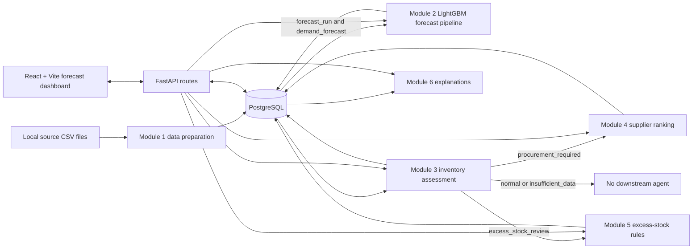

# Inventory Optimization and Excess Stock Management System

A software-based decision-support project for retail inventory planning. It combines historical sales and inventory data with a short-horizon demand forecast, deterministic inventory rules, supplier ranking, excess-stock classification, and explanations. It does not autonomously place orders or change stock quantities.

> **Project status:** This repository contains implementation for the six project modules, but this is not a production release. The dated audit on 2026-10-26 passed the listed regression suites and basic API checks; live database-backed orchestration was not exercised. See [Current limitations](#current-limitations-and-known-issues) before using recommendations.

## Problem statement and objectives

Retailers must balance stockout risk against excess inventory while working with uncertain demand, supplier lead times, and slow-moving products. This project aims to:

- organize product, supplier, inventory-batch, sales, and daily-demand data in PostgreSQL;
- forecast daily product demand over a seven-day horizon and compare model forecasts with a moving-average baseline;
- estimate safety stock, reorder points, and suggested replenishment quantities;
- route inventory assessments to a supplier recommendation or excess-stock review when the rules indicate it;
- provide feature-level or rule-based explanations where the stored data and model artifacts support them.

The outputs are advisory decision support. Managers remain responsible for purchasing, markdowns, returns, write-offs, and other operational actions.

## Features and implementation status

- **Data management — implemented:** scripts profile, validate, preprocess, load, and aggregate the supplied retail data into PostgreSQL.
- **Demand forecasting — implemented:** a global LightGBM regression model generates recursive seven-day forecasts. A seven-calendar-day moving-average baseline and chronological evaluation are included.
- **Inventory optimization — implemented:** deterministic safety-stock, reorder-point, replenishment, and routing calculations are exposed through the API.
- **Procurement — implemented with a limited ranking policy:** eligible suppliers are ranked by ascending recorded lead time; ties are broken by supplier ID. The top two may be returned. Price optimization, supplier-quality scoring, and automated ordering are not implemented.
- **Excess-stock assessment — implemented as deterministic/statistical rules:** population revenue ranking (ABC), demand variability classification (XYZ), and overstock/slow-moving/dead-stock flags produce an advisory action. The current static data may not exercise every route.
- **Explainability — implemented:** TreeSHAP is used for supported LightGBM forecast predictions; inventory, procurement, and excess-stock decisions use their calculation rules rather than SHAP.
- **API — implemented:** FastAPI routers cover the forecast and inventory decision workflows. Some write paths have not been verified against a disposable live database.
- **Web dashboard — implemented for Module 2:** the React interface shows forecast summaries, product forecasts, run history, and evaluation metrics. It is not a complete UI for Modules 3–6.
- **Scheduled forecasting — implemented as an optional separate process:** APScheduler can run forecasts weekly. Training is manual; scheduling is not started by the API.

## System architecture

The shared FastAPI application imports the forecasting and inventory-related routers. Module 2's pipeline trains a model or generates and stores forecasts. Module 3 consumes the latest completed forecast plus product, sales, supplier, and latest-batch stock data. Native Python orchestration uses Module 3's decision to invoke **at most one** downstream agent: procurement or excess stock. Normal and insufficient-data decisions do not invoke either agent. Module 6 can explain supported forecast and persisted decision records. The React application currently calls forecast endpoints only.



The diagram shows available paths, not that every request executes all modules. Module 3 determines the routing decision; the native orchestration function calls at most one of Modules 4 and 5.

### Module-wise description

| Module | Responsibility, inputs, and outputs | Implementation and status |
|---|---|---|
| **1 — Data Management** | Validates and normalizes source CSVs, creates the base schema, loads entities and transactions, and aggregates `daily_demand`. | Scripts and DDL are in [`module1_data_management/`](module1_data_management/). Raw inputs are expected under root `Dataset\`; that directory is ignored by Git. |
| **2 — Demand Forecasting** | Builds calendar-complete per-product demand histories, creates lag/rolling/calendar features, trains a global model, evaluates it, and persists forecast runs and daily predictions. | [`module2_demand_forecasting/`](module2_demand_forecasting/) contains the Python pipeline, scheduler, tests, reports, and schema. Forecast horizon is seven days. Model artifacts are local generated files, not source-controlled inputs. |
| **3 — Inventory Optimization** | Combines latest-batch stock, demand history, the latest forecast, product limits, and supplier lead time. Outputs safety stock, reorder point, replenishment quantity, and a routing decision. | Calculations and persistence are under `backend/services/`; router and DDL are in `backend/routes/inventory_optimization.py` and `module3_inventory_optimization/sql/schema_m3.sql`. |
| **4 — Procurement Agent** | Uses product-supplier links and supplier master lead times to rank up to two alternatives for a product. Returns a recommendation requiring manager approval. | Implemented in `backend/agents/procurement_agent.py` and `backend/services/supplier_alternatives_import.py`, with API routes in `backend/routes/procurement.py` and DDL in `module3_inventory_optimization/sql/schema_m4.sql`. It does not rank by price or supplier quality and does not place orders. |
| **5 — Excess Stock Management Agent** | Classifies revenue contribution (ABC), demand variability (XYZ), and excess-stock conditions, then returns a suggested review action and warnings. | Implemented in `backend/agents/excess_stock_agent.py` and `backend/services/excess_stock_service.py`, with routes in `backend/routes/excess_stock.py` and DDL in `module3_inventory_optimization/sql/schema_m5.sql`. No stock or purchase data is mutated. |
| **6 — Explainability** | Produces TreeSHAP feature contributions for supported forecast predictions and rule/statistical explanations for stored Modules 3–5 results. | Implemented in `backend/services/explainability_service.py` and `backend/routes/explainability.py`; DDL for optional explanation persistence is `module3_inventory_optimization/sql/schema_m6.sql`. |

Modules 4 and 5 do not have separate top-level module directories in this working tree; their implementation is integrated into `backend/`.

#### Implemented decision methods

- **Module 3:** safety stock is `ceil(z × daily_demand_stddev × sqrt(lead_time_days))` (default `z = 1.645`). The reorder point is `ceil(avg_daily_demand × lead_time_days + safety_stock)`. Forecast average is preferred when supplier lead time is within the seven-day horizon; otherwise historical demand is used. The replenishment quantity is based on the maximum-stock order-up-to level and applies the minimum order quantity when a positive quantity is needed. Missing stock or lead-time data produces `insufficient_data`. A position at or below computed ROP or the product's static reorder level routes to procurement; otherwise a position above `1.5 × maximum_stock_level` routes to excess-stock review; procurement has priority when signals conflict.
- **Module 4:** eligible supplier alternatives are ordered by ascending lead time, then supplier ID for deterministic ties; up to two are returned. It does not calculate a cost/quality optimum.
- **Module 5:** ABC classes use cumulative 12-month revenue shares (A through 70%, B through 90%, then C). XYZ classes use the coefficient of variation of 90-day gap-filled demand (X at CV ≤ 0.30, Y at CV ≤ 0.60, otherwise Z). The service flags overstock above 1.5 times maximum stock, slow-moving stock with fewer than seven nonzero-demand days and positive stock, and dead stock with zero demand and positive stock. Dead-stock classification takes precedence over overstock, then slow-moving.
- **Module 6:** exact TreeSHAP contributions are available for supported LightGBM forecast rows. Module 3 and 4 explanations summarize deterministic formulas/ranking; Module 5 explanations describe its statistical classifications. These rule-based decisions are not SHAP model explanations.

## Technology stack

| Technology | Role |
|---|---|
| Python | Data processing, forecasting, API, decision services, and tests. The current root environment was tested with Python 3.11.9; no Python version is pinned in a project runtime file. |
| FastAPI, Pydantic, Uvicorn | Shared HTTP API, request/response validation, and development server. |
| PostgreSQL, psycopg2-binary | Persistent relational data and forecast/assessment records. SQLAlchemy is listed as a dependency, but backend DB access uses psycopg2 directly. |
| pandas, NumPy, scikit-learn | Data preparation, feature construction, evaluation, and product encoding. |
| LightGBM, joblib | Demand model and local model artifact serialization. |
| SHAP | TreeSHAP forecast explanations; not used to explain deterministic inventory rules. |
| APScheduler | Optional weekly forecast scheduler process. |
| React, React DOM, Vite | Forecast dashboard and frontend development/build tooling. |
| Axios, Plotly | Frontend API requests and interactive visualizations. |
| pytest, pytest-asyncio, httpx | Python unit and API/service tests. |

Python dependency lower bounds are listed in [`requirements.txt`](requirements.txt). Frontend dependencies and a lockfile are in [`frontend/package.json`](frontend/package.json) and [`frontend/package-lock.json`](frontend/package-lock.json). The lockfile resolves Vite 8.3.4, whose runtime requires Node.js `^20.19.0` or `>=22.12.0`; a Node/npm version is not pinned by this repository. No PostgreSQL server version is pinned.

## Repository structure

```text
.
├── backend/
│   ├── agents/                 # Native orchestration and Modules 4–5 agents
│   ├── routes/                 # FastAPI routers for Modules 2–6
│   └── services/               # Database access and module calculations
├── frontend/
│   └── src/
│       ├── api.js              # Client for the forecast API
│       └── pages/              # Dashboard, Products, Run History, Metrics
├── module1_data_management/
│   ├── config/                 # Database and input path configuration
│   ├── sql/schema.sql          # Base PostgreSQL schema
│   ├── src/                    # Validation, preprocessing, load, aggregation
│   └── tests/
├── module2_demand_forecasting/
│   ├── config/                 # Shared .env settings and forecast config
│   ├── reports/                # Evaluation reports/metrics
│   ├── sql/schema_m2.sql       # Forecast tables
│   ├── src/                    # Features, training, evaluation, forecast, scheduler
│   └── tests/
├── module3_inventory_optimization/
│   ├── sql/                    # DDL for Modules 3–6
│   └── tests/                  # Inventory, procurement, excess stock, routing
├── module6_explainability/
│   └── tests/
├── reports/                    # Backend audit and handover evidence
├── Dataset/                    # Local-only input data; ignored by Git
├── requirements.txt
└── README.md
```

Generated data, model artifacts, virtual environments, `node_modules`, logs, and caches are intentionally omitted from this tree. Dataset and model files are excluded by [`.gitignore`](.gitignore).

## Prerequisites

- Git.
- Python 3.11 is the version recorded in the current audit environment (3.11.9); there is no repository-enforced Python version.
- Node.js `^20.19.0` or `>=22.12.0` for the Vite version resolved by the lockfile, plus npm. The project does not pin an npm version.
- A PostgreSQL server and a database user with permission to create the project database and tables. The repository does not pin a PostgreSQL version.
- The four Module 1 source CSV files, available separately from Git, in the expected root `Dataset\` directory.
- For forecasting and forecast explainability, a populated base database and compatible trained model artifacts. Training can generate the model artifacts; no artifact download command is provided.

## Installation and setup (Windows PowerShell)

Run commands from the repository root unless a step changes directories.

### 1. Clone and install dependencies

```powershell
git clone https://github.com/Amarnath202/Inventory-Optimization.git
Set-Location Inventory-Optimization

py -3.11 -m venv .venv
.\.venv\Scripts\Activate.ps1
python -m pip install --upgrade pip
python -m pip install -r requirements.txt

Set-Location frontend
npm ci
Set-Location ..
```

If PowerShell prevents virtual-environment activation, use the interpreter directly as shown in the run and test commands below.

### 2. Configure PostgreSQL

Create a local database using your PostgreSQL administration tool, or (if PostgreSQL command-line tools are on `PATH`) run:

```powershell
createdb -U postgres inventory_optimization_db2
```

Create the root `.env` from the checked-in root template and edit it locally:

```powershell
if (-not (Test-Path .env)) {
    Copy-Item .env.example .env
} else {
    Write-Host "Existing .env preserved; edit it directly."
}
notepad .env
```

Set `DB_HOST`, `DB_PORT`, `DB_NAME`, `DB_USER`, and `DB_PASSWORD` for your own PostgreSQL instance. `DATABASE_URL` is optional; if used, set it to a DSN matching those credentials. Module 1 and Module 2 load the root `.env`. Do not put real credentials in source control or share them in reports.

The default database name in configuration is `inventory_optimization_db2`. The configuration defaults to `localhost:5432` and user `postgres`; the password default is empty and should be set for a local installation.

### 3. Provide the source data and build the base database

The expected input filenames, which must be obtained separately, are:

```text
Dataset\supplier_THRESHOLD_FINAL.csv
Dataset\product_THRESHOLD_FINAL.csv
Dataset\inventory_THRESHOLD_FINAL.csv
Dataset\sales_THRESHOLD_FINAL.csv
```

The repository `.gitignore` excludes `Dataset\`; these source files are not distributed in Git. The setup cannot complete without them. From the repository root, run the Module 1 stages in order:

```powershell
$env:PYTHONUTF8 = '1'
.\.venv\Scripts\python.exe module1_data_management\src\inspect_data.py
.\.venv\Scripts\python.exe module1_data_management\src\validate_data.py
.\.venv\Scripts\python.exe module1_data_management\src\preprocess.py
.\.venv\Scripts\python.exe module1_data_management\src\build_schema.py
.\.venv\Scripts\python.exe module1_data_management\src\load_database.py
.\.venv\Scripts\python.exe module1_data_management\src\build_daily_demand.py
```

These commands create normalized tables and `daily_demand` in PostgreSQL. Review the scripts and target database before running them; database loading is a write operation. In particular, do not use `module1_data_management\data\processed\sale.csv` as a complete reload source: the 2026-10-26 audit found that local generated file contained only a header and one fixture row.

### 4. Create the forecasting schema, train, and forecast

Module 2 expects the Module 1 tables to exist. Run its schema creation command and training pipeline from the repository root:

```powershell
.\.venv\Scripts\python.exe module2_demand_forecasting\src\pipeline.py --create-schema
.\.venv\Scripts\python.exe module2_demand_forecasting\src\pipeline.py --train
.\.venv\Scripts\python.exe module2_demand_forecasting\src\pipeline.py --forecast
```

Training loads data from PostgreSQL, saves model/encoder/metadata files under `module2_demand_forecasting\models\`, and writes validation/test metrics under `module2_demand_forecasting\reports\`. Forecasting uses the existing trained model and writes forecast-run and forecast rows to PostgreSQL. Both steps are database operations; use a database you are authorized to modify.

The Module 3–6 schema files are under `module3_inventory_optimization\sql\schema_m3.sql` through `schema_m6.sql`. There is no root-level all-modules migration command. Some API workflows apply their module schema as part of assessment/import execution, but this is not a substitute for reviewing DDL and testing on a disposable database. The audit on 2026-10-26 found `excess_stock_assessment` absent in its shared database and `explanation_record` absent (the latter is optional in the Module 6 design). Do not use a shared or production database to discover or create schemas.

### 5. Supplier alternatives (optional)

Module 4 can import additional supplier alternatives with `POST /api/procurement/import-supplier-alternatives`. The importer expects the external `module4_all_supplier_lead_time_ranking.csv` source in the configured dataset location and validates IDs against the existing product and supplier tables. The source data is not tracked by Git. The import writes to `product_supplier`; only run it against a database you intend to update.

## Running the application

### Backend API

From the repository root, after PostgreSQL is running and `.env` is configured:

```powershell
.\.venv\Scripts\python.exe -m uvicorn backend.main:app --reload --port 8000
```

The app is configured with API docs at [http://127.0.0.1:8000/docs](http://127.0.0.1:8000/docs), ReDoc at [http://127.0.0.1:8000/redoc](http://127.0.0.1:8000/redoc), root status at `http://127.0.0.1:8000/`, and health at `http://127.0.0.1:8000/health`. Database-backed routes need PostgreSQL and the relevant tables/data; `/health` itself is a basic process check.

### Frontend

In a second terminal:

```powershell
Set-Location frontend
npm run dev
```

Vite normally serves the UI at `http://localhost:5173`. The frontend API client has `http://localhost:8000` hard-coded as its backend base URL. The backend's CORS configuration is development-oriented.

### Optional weekly scheduler

In another terminal, with PostgreSQL and the forecast schema available:

```powershell
.\.venv\Scripts\python.exe module2_demand_forecasting\src\scheduler.py
```

The scheduler is a separate process, uses the configured Module 2 weekly schedule (default Sunday 02:00 Asia/Kolkata), and does not train models. Keep its host awake and running. Missed forecasts require manual recovery; training is never scheduled.

## Database entities and data flow

The primary tables defined by the checked-in schemas are:

| Table(s) | Purpose |
|---|---|
| `supplier`, `product`, `product_supplier` | Supplier and product masters plus supplier relationships. |
| `inventory_batch` | Inventory batch history; Module 3 uses the most recent batch's `current_quantity`, not a sum of historical batch quantities. |
| `sale`, `sale_item`, `daily_demand` | Sales headers, line items, and product-day demand aggregates. `daily_demand` contains observed sale dates; Module 2 fills calendar gaps within each product's observed history with zero-demand days. |
| `forecast_run`, `demand_forecast` | Forecast run metadata and per-product, per-date forecast output. |
| `inventory_assessment` | Module 3 stock/demand inputs, calculation results, and routing decision. |
| `procurement_recommendation` | Module 4 advisory supplier ranking and approval flag. |
| `excess_stock_assessment` | Module 5 ABC/XYZ, category, and recommended review action. |
| `explanation_record` | Optional persisted explanation metadata and JSON output. |

The core DDL is in `module1_data_management\sql\schema.sql`, the forecast DDL in `module2_demand_forecasting\sql\schema_m2.sql`, and the inventory/procurement/excess-stock/explanation DDL in `module3_inventory_optimization\sql\`. Base input rows are prerequisites for downstream modules. Schemas are not a substitute for loading the source data or training a compatible forecast model.

## API overview

The shared FastAPI app registers routes from `backend/main.py`. The table below lists actual route paths and their purpose; request models, parameters, and response shapes are detailed in the interactive OpenAPI UI.

| Method | Route | Purpose |
|---|---|---|
| `GET` | `/` | API service summary. |
| `GET` | `/health` | Basic API health. |
| `GET` | `/api/forecast/overview` | Latest forecast-run overview. |
| `GET` | `/api/forecast/products` | Products with forecasts; optional `run_id`. |
| `GET` | `/api/forecast/products/{product_id}` | Product forecast and demand/stock detail. |
| `GET` | `/api/forecast/top` | Top forecasted demand products. |
| `GET` | `/api/forecast/table` | Paginated forecast rows. |
| `GET` | `/api/forecast/runs`, `/api/forecast/runs/{run_id}` | Forecast run history/details. |
| `GET` | `/api/forecast/metrics` | Saved validation/test metric CSVs, when present. |
| `POST` | `/api/forecast/trigger` | Queue a forecast run in the API background task. |
| `GET` | `/api/inventory-optimization/overview` | Inventory decision counts. |
| `GET` | `/api/inventory-optimization/products` | Paginated inventory assessments with optional decision filter. |
| `GET` | `/api/inventory-optimization/products/{product_id}` | Product assessment detail. |
| `POST` | `/api/inventory-optimization/assess` | Assess one product or queue a full assessment. |
| `GET` | `/api/inventory-optimization/recommendations` | Products requiring procurement or excess-stock review. |
| `GET` | `/api/orchestration/status` | Orchestration engine, routing, and stated limitations. |
| `POST` | `/api/orchestration/run` | Run Module 3 assessment and conditionally one downstream agent for one product. |
| `GET` | `/api/orchestration/run/{run_id}` | Retrieve a process-local orchestration result. |
| `POST` | `/api/procurement/import-supplier-alternatives` | Validate and add supplier-product links from the alternatives CSV. |
| `GET` | `/api/procurement/recommend/{product_id}` | Return and persist a lead-time-based supplier recommendation. |
| `GET` | `/api/procurement/suppliers/{product_id}` | List a product's supplier alternatives. |
| `GET` | `/api/procurement/recommendations` | List stored procurement recommendations. |
| `POST` | `/api/excess-stock/assess` | Assess and attempt to persist one product's excess-stock result. |
| `GET` | `/api/excess-stock/assessments`, `/api/excess-stock/assessments/{product_id}` | List or retrieve excess-stock assessments. |
| `GET` | `/api/excess-stock/summary` | Excess-stock category summary. |
| `GET` | `/api/explainability/health`, `/api/explainability/models` | Explainability and model/artifact availability. |
| `GET` | `/api/explainability/forecast/{product_id}` | Explain a stored forecast using TreeSHAP when artifacts are available. |
| `GET` | `/api/explainability/inventory/{assessment_id}` | Explain a stored inventory assessment. |
| `GET` | `/api/explainability/procurement/{recommendation_id}` | Explain a stored supplier ranking. |
| `GET` | `/api/explainability/excess-stock/{assessment_id}` | Explain a stored excess-stock assessment. |

The forecast trigger queues background work and returns an accepted response; check `/api/forecast/runs` for completion. Some API calls are not read-only despite using `GET`: `/api/procurement/recommend/{product_id}` persists a recommendation in the current implementation. `POST` assessment, orchestration, and import operations can write records or schema. The latest audit verified API startup and selected GET checks, not every endpoint end to end.

The forecast trigger accepts an optional `reason`. Inventory assessment accepts an optional `product_id`; omitting it queues a full assessment. Orchestration requires `product_id` and optionally accepts `trigger_reason`. Excess-stock assessment requires `product_id`. The orchestration response includes the request ID, execution status, routing decision, agent results, errors/notices, and `manager_action_required`; the API sets that approval flag to `true`.

## Forecasting and evaluation

Module 2 trains a **global LightGBM regressor** using data from the shared PostgreSQL `daily_demand` and product tables. The preprocessing stage creates a calendar-complete series between each product's first and last observed sale dates; missing dates in that interval are treated as zero demand. Leakage-safe features include lags (1, 2, 3, 7, 14, 21, and 28 days), shifted rolling means and standard deviations, calendar fields, and an encoded product identifier.

Training uses chronological splits: training through 2026-05-31, validation through 2026-07-15, and test through 2026-08-30 in the configured dataset. The training workflow saves a LightGBM model, product encoder, metadata, and validation/test metrics. Evaluation compares the model with a seven-calendar-day moving-average baseline and reports MAE, RMSE, WAPE, and sMAPE. WAPE is undefined (reported as `None`/N/A) when total actual demand is zero. Metrics are forecasting error measures; they are not product-level win rates or proof of business outcomes.

Inference uses the latest ingested demand date plus one day as forecast origin and generates seven recursive daily predictions per eligible product, flooring predictions at zero. The pipeline checks source data freshness and uses a PostgreSQL advisory lock to avoid concurrent runs. A scheduled forecast is optional and separate from the API; no scheduled retraining or automatic missed-run catch-up is implemented.

The configured data horizon and committed metric reports are dataset-specific. The 2026-10-26 audit observed a latest completed database forecast targeting 2026-08-31 through 2026-09-06. Treat that as a historical observation, not a guarantee about another database or current performance. Refresh input data and forecasts and rerun evaluation before operational use.

## Orchestration and decision logic

Orchestration is native Python in `backend/agents/orchestration.py`, not a graph framework. For one product:

1. Module 3 retrieves the latest inventory batch and forecast data and calculates inventory metrics.
2. Its decision is retained as the routing result:
   - `procurement_required` invokes Module 4;
   - `excess_stock_review` invokes Module 5;
   - `normal` skips both downstream agents;
   - `insufficient_data` stops without a downstream handoff.
3. Module 6 may explain supported persisted results.
4. The API returns a unified result and keeps the orchestration lookup history in process memory.

Safety behavior in code requires manager action and does not place purchase orders or update inventory quantities. Assessment and recommendation records may still be written. Routing branches and agent behavior have mock/isolation coverage, but a real database-backed orchestration POST was not run in the cited audit.

## Testing and validation

The project uses pytest. From the repository root, run the regression suites with the project virtual environment:

```powershell
$env:PYTHONUTF8 = '1'
$env:PYTHONPATH = "$PWD;$PWD\module2_demand_forecasting;$env:PYTHONPATH"

.\.venv\Scripts\python.exe -m pytest module1_data_management\tests -q --tb=short
.\.venv\Scripts\python.exe -m pytest module2_demand_forecasting\tests -q --tb=short -c module2_demand_forecasting\pytest.ini
.\.venv\Scripts\python.exe -m pytest module3_inventory_optimization\tests -q --tb=short
.\.venv\Scripts\python.exe -m pytest module6_explainability\tests -q --tb=short -c module6_explainability\pytest.ini
```

The most recent recorded run in [`backend/HANDOVER.md`](backend/HANDOVER.md) and [`reports/final_backend_audit_2026-10-26.md`](reports/final_backend_audit_2026-10-26.md) reports 17, 26, 197, and 82 passing tests respectively (322 total) on 2026-10-26. These are dated results, not a test run performed by this README update. Module 1 tests use the configured PostgreSQL database; Module 3–6 API/service tests primarily mock database behavior. Passing mocked tests do not verify database-backed end-to-end writes. The ad-hoc `audit_integration.py` is not a safe default test command: the audit determined it can import supplier alternatives and issue state-changing requests.

## Security and data safety

- Keep local credentials in the root `.env`; `.env` and `.env.*` are ignored, while the root `.env.example` template remains trackable. Never commit passwords, tokens, or connection strings.
- The `Dataset\` directory and generated forecasting model artifacts are ignored. Obtain data and model artifacts through authorized project channels; do not commit private or sensitive data.
- Use a disposable test database for setup, schema creation, forecast generation, supplier imports, assessments, and orchestration. These operations can write database records.
- The application does not implement automatic purchasing or inventory quantity updates. Do not interpret recommendations as orders or execute manager actions without an authorized review.
- CORS in `backend/main.py` includes broad development settings. Review and restrict it before deployment.
- No deployment configuration or production secret-management integration is provided.

## Current limitations and known issues

Verified against the current source and the dated audit report:

- **Data and forecast freshness:** the source data configured for Module 2 ends at 2026-08-30. The 2026-10-26 audit observed forecast targets in August/September 2026 and a latest-batch inventory snapshot dated 2026-08-01. These are historical inputs, not live stock or demand.
- **Database readiness:** the audit's shared database did not contain `excess_stock_assessment`; the optional `explanation_record` table was also absent. A live database-backed Module 4/5 orchestration run was intentionally not attempted because that endpoint persists results and may apply schema. Provision and verify a separate disposable integration database before relying on these paths.
- **Local-only assets:** `Dataset\` and trained model artifacts are excluded from Git. No dataset download or model artifact bootstrap script is provided; obtain the data or retrain locally.
- **Supplier assumptions:** supplier lead times are modelled/synthetic and do not verify actual supplier performance. The audit found many product-supplier links without purchase rates or minimum order quantities. Ranking considers lead time only, not price, quality, or other operational criteria.
- **Stock and purchase-order scope:** Module 3 uses the most recent inventory-batch quantity as a static snapshot. Purchase orders, backorders, and a live stock ledger are not tracked.
- **Stockout prediction:** the planned XGBoost stockout predictor is deferred because the data lacks reliable stockout labels. Zero sales alone cannot distinguish a stockout from no demand.
- **Excess-stock routing:** the Module 5 assessment rules exist, but the agent is conditional on Module 3 routing. The Module 5 source describes that the current static inventory snapshot did not route products to the excess-stock branch.
- **Orchestration history:** run results are cached in process memory and disappear when the API restarts.
- **Frontend scope:** the React dashboard is forecast-focused and does not expose the full Module 3–6 decision workflow as a user interface.
- **Integration validation:** the dated regression suites pass, but relevant downstream API tests primarily mock database calls; the live database-backed orchestration POST remains unverified. The audit marked the backend not ready to freeze or integrate against its shared database.

## Future improvements

Potential follow-up work, not claims about existing functionality:

- Provision a disposable database and add safe database-backed integration tests for schema creation, routing, persistence, and no unintended stock or purchase-order changes.
- Replace static snapshots and modelled supplier lead times with validated, regularly refreshed operational data.
- Add supplier-price/MOQ/quality-aware ranking only when the relevant data is trustworthy.
- Add reliable inventory snapshots or manual stockout labels before implementing and evaluating a stockout predictor.
- Persist orchestration run history and add a frontend workflow for inventory, procurement, excess stock, and explanations.
- Define deployment configuration, narrow CORS origins, and document a supported runtime/database version matrix.

## Project status and academic context

This repository is a final-year software project and decision-support prototype. The implementation includes forecasting, inventory calculations, native routing, supplier and excess-stock recommendations, explanations, and a forecast dashboard. The audit dated 2026-10-26 recorded passing regression tests and basic API checks, but identified missing database tables and did not verify live database-backed orchestration. Do not describe the system as deployed, production-ready, or fully end-to-end verified.
